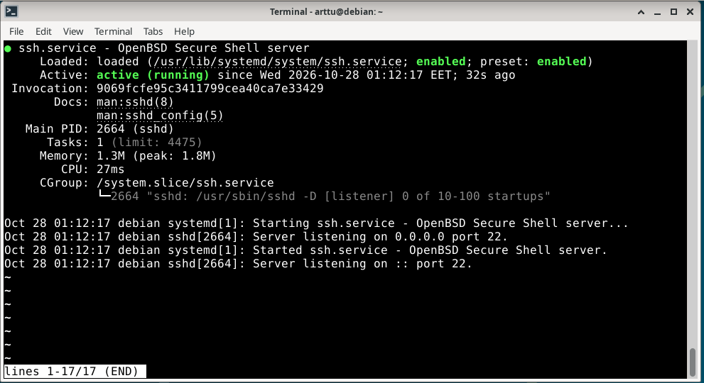
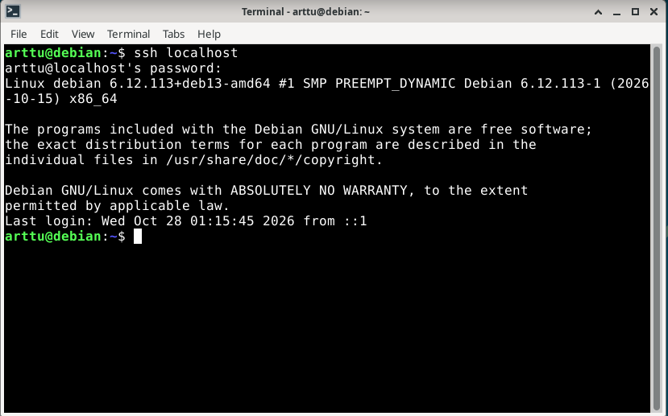
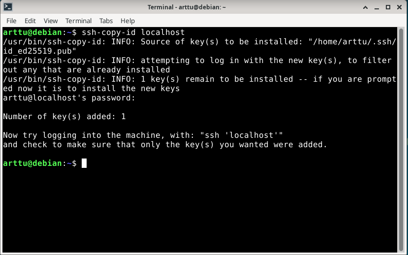
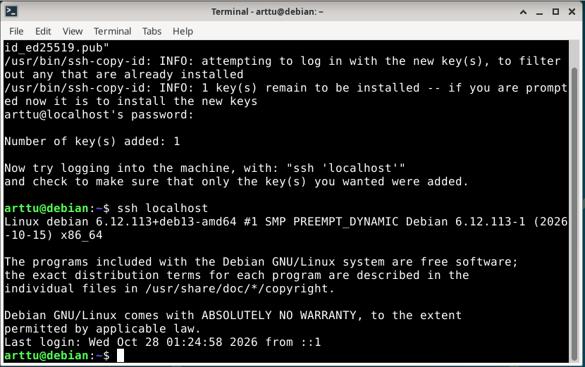
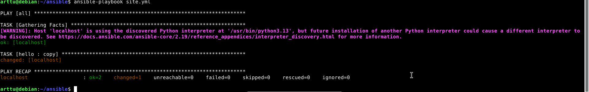

# H1 Tehtävät

## x) Karvinen 2026: SSH public key - Login without password

- SSH avaimella voidaan kirjautua Linux-koneeseen ilman salasanaa.
- Komennolla "ssh-keygen" luodaan julkinen ja yksityinen avain. Yksityinen avain pidetään salassa, koska sillä tunnistaudutaan palvelimelle.
- Komennolla "ssh-copy-id" kopioidaan julkinen SSH-avain palvelimelle, johon halutaan kirjautua. Avain tallennetaan käyttäjän "~/.ssh/authorized_keys" tiedostoon, jolloin palvelin voi tunnistaa vastaavalla yksityisellä avaimella kirjautuvan käyttäjän.
- SSH-yhteyden toiminta kokeillaan komennolla "ssh localhost".

Huomio: SSH-avaimet helpottavat ja nopeuttavat kirjautumista ja sopivat hyvin palvelinten hallintaan.

## Karvinen 2026: Hello Ansible

- Ansible on työkalu, jolla voidaan automatisoida Linux-palvelinten hallintaa.
- Ansiblella voidaan esimerkiksi tehdä asetuksia useille koneille ilman, että jokainen vaihe täytyy suorittaa käsin.
- Ansible käyttää SSH-yhteyttä muodostaakseen yhteyden hallittaviin koneisiin.
- Ansible-rooleilla voidaan järjestää automatisointitehtävät osiin, joissa määritellään esim. tiedostot ja toiminnot, joita koneella halutaan toteuttaa.
- Ansiblella määritellään haluttu lopputulos, jolloin sama tehtävä voidaan suorittaa uudelleen ilman muutoksia.

Huomio: Ansible on erityisen hyödyllinen silloin, kun hallittavia palvelimia on useita, koska samat asetukset voidaan toteuttaa automaattisesti.

## a) Debian 13 paikallisesti virtuaalikoneeseen

Linuxin asennuksessa hyödynsin Thomas Punnalan raportin ohjeita VirtualBoxin asetusten määrittämiseen ja Debian 13:n asentamiseen ja tein samat asiat kuin hänen raportissa.

- Virtualisointiohjelma: Oracle VirtualBox.
- Käyttöjärjestelmä: Debian 13 (amd64).
- Virtuaalikoneen RAM-muisti: 4096 MB.
- Suoritinytimet: 2.
- Virtuaalilevyn koko: 20 GB.
- Levytyyppi: VDI.
- Asennuskuva: debian-live-13.7.0-amd64-xfce.iso.

## b) Sshecrets

Asensin SSH-palvelimen komennolla "sudo apt-get -y install ssh".

Käynnistin palvelun komennolla "sudo systemctl enable --now ssh" Komennolla SSH demoni menee päälle myös jokaisella uudelleenkäynnistyksellä.
Tarkistin, että palvelu on käynnissä komennolla "sudo systemctl status ssh".

Testasin SSH-yhteyttä komennolla "ssh localhost". Kirjautuminen onnistui Debian-käyttäjän salasanalla.

## c) Pubkey

Tässä tehtävässä automatisoin SSH-kirjautumisen julkisella avaimella. Loin ensin avainparin komennolla "ssh-keygen".
Kopioin julkisen avaimen komennolla "ssh-copy-id localhost".

Kokeilin kirjautumista komennolla "ssh localhost". Kirjautuminen onnistui ilman kysymättä salasanaa.

## d) Hei Ansible

Asensin Ansiblen komennolla sudo apt-get install ansible. Asensin myös ohjelmat micro, bash-completion ja tree niiden hyödyllisyyden vuoksi. Loin ansible-kansion, jonne loin hosts.ini-tiedoston.
Nyt lisäsin tiedostoon hallittavaksi koneeksi vain localhostin. Loin myös tiedoston ansible.cfg, johon kirjoitin "[defaults] inventory = hosts.ini". Tämä kertoi Ansiblelle, että hosts.ini on oletus, joten sitä ei tarvitse koko ajan määrittää erikseen.

Tein site.yml playbookin, joka listaa mitkä tietokoneet saavat mitkä konfiguraatiot. Tällä saan jokaiselle tietokoneelle (tässä tapauksessa vain localhost) roolin "hello": 
- hosts: all
  roles:
   - hello
 
Loin vielä roolin "hello" tiedostoon "roles/hello/tasks/main.yml". 
Suoritin playbookin komennolla "ansible-playbook site.yml".

## Lähteet

Karvinen, T. 2026. Hello Ansible. Luettavissa: https://terokarvinen.com/hello-ansible/. Luettu: 28.10.2026.

Karvinen, T. 2026. SSH Public Key - Login Without Password. Luettavissa: https://terokarvinen.com/ssh-public-key-login-without-password/. Luettu: 28.10.2026.

Punnala, T. 2025. H1 Installing Linux. GitHub. Luettavissa: https://github.com/punnalathomas/linux-course/blob/main/h1-installing-linux.md. Luettu: 28.10.2026.
