# H2 Tehtävät

## x) Karvinen 2026: Sudo without password

- Sudo ilman salasanaa mahdollistaa komentojen suorittamisen pääkäyttäjän oikeuksilla.
- Salasanaton sudo määritetään luomalla lisäämällä käyttäjä käyttäjäryhmään "sudoless". Tämän jälkeen luodaan uusi sudoers-sääntö komennolla ```sudo visudo /etc/sudoers.d/sudoless.```
- Sudoers tiedostoon lisätään ```%sudoless ALL = (ALL) NOPASSWD: ALL```. Tämä komento sallii ryhmän jäsenille kaikkien komentojen suorittamisen ilman salasanaa.
- Toimivuus kokeillaan kirjautumalla ulos, uudelleen sisään ja suorittamalla jokin sudo-komento.
- ```sudo -k``` poistaa aiemmin tallennetut kirjautumistiedot.

Kysymys: Mitä riskejä salasanattomasta sudon käytöstä aiheutuu, jos käyttäjätili joutuu ulkopuolisen haltuun?

## Munroe 2006: xkcd 149: Sandwich

- Sarjakuvassa henkilö pyytää toista tekemään hänelle voileivän. Kun toinen kieltäytyy, ensimmäinen lisää pyyntöön sanan sudo, minkä jälkeen toinen suostuu.
- Huumori perustuu sudoon, jolla voidaan suorittaa komentoja pääkäyttäjän oikeuksilla.

## Karvinen 2026: Passwordless Sudo with Ansible

- Artikkelissa esitellään Ansibleen tehty Antero-rooli, jolla automatisoidaan salasanattoman sudon käyttöönotto. Rooli luo uuden käyttäjän sudoless ryhmään.
- Ennen automatisointia kannattaa aina kokeilla ensin manuaalisesti.
- Main.yml:iin lisätään group-, user-, authorized_key- ja copy kohdat. Niillä luodaan ryhmä ja käyttäjä, lisätään SSH-avain ja luodaan sudoers-tiedosto.
- Ensimmäisellä ajokerralla tarvitaan sudo-oikeudet. Tämä toteutetaan lisäämällä ```become: true``` site.yml tiedostoon.

Kysymys: Miten salasanaton sudo voidaan ottaa käyttöön Ansiblella usealla palvelimella samaan aikaan?

## Ansible-doc

### Ansible-doc copy

- Voi kopioida tiedostoja tai hakemistorakenteita paikalliselta tai etäkoneelta kohdekoneelle.
- Voi määrittää tiedostojen ja hakemistojen käyttöoikeuksia ja omistajuutta.

#### Content
- Määrittää tiedoston sisällön.
- Toimii vain, kun ```dest``` osoittaa tiedostoon.
- Luo tiedoston, jos sitä ei vielä ole olemassa.

#### Dest
- Määrittää kohteen polun, johon tiedosto kopioidaan.

#### Src
- Määrittää kopioitavan tiedoston tai hakemiston.

#### Owner
- Määrittää käyttäjän, joka omistaa tiedoston tai tiedostojärjestelmän.
- Jos asetusta ei käytetä, käyttää nykyistä käyttäjää.

#### Group
- Määrittää ryhmän, jolle tiedosto tai tiedostojärjestelmän kohde kuuluu.
- Jos asetusta ei käytetä, käytetään nykyisen käyttäjän ryhmää.

#### Mode
- Määrittää tiedoston tai hakemiston käyttöoikeudet.
- Oikeudet voidaan määrittää oktaalilukuina, kuten 0644 tai 0777 tai symbolisesti, kuten esim. u=rw,g=r,o=r
- Preserve-asetuksella tiedostolle annetaan samat käyttöoikeudet kuin lähdetiedostolla.

#### Copy esimerkki

```
- name: Copy file with owner and permissions
  ansible.builtin.copy:
    src: /srv/myfiles/foo.conf
    dest: /etc/foo.conf
    owner: foo
    group: foo
    mode: '0644'
```

### Ansible-doc apt

- Hallitsee apt-paketteja esimerkiksi Debian- ja Ubuntu-käyttöjärjestelmissä.

#### Name
- Määrittää käsiteltävän apt-paketin nimen.
- Dokumentaatiosta ei löytynyt suoraa selitystä, joten käyttötarkoituksen päättelin esimerkkien perusteella.

#### State
- Määrittää paketin halutun tilan.
- Esimerkeissä käytetään arvoja "present", "absent" ja "latest".

#### Update_cache
- Päivittää apt-pakettien välimuistin.
- Esimerkeissä käytetään arvoa "yes".
- Dokumentaatiosta en löytynyt selitystä, joten käyttötarkoituksen päättelin esimerkkien perusteella.

#### Apt esimerkki

```
- name: Install apache httpd (state=present is optional)
  ansible.builtin.apt:
    name: apache2
    state: present
```

### Ansible-doc file

- Voi määrittää tiedostojen, hakemistojen ja symbolisten linkkien ominaisuuksia.
- Voi myös luoda ja poistaa tiedostoja, symbolisia linkkejä tai hakemistoja.

#### Path
- Määrittää hallittavan tiedoston polun.

#### Recurse
- Määrittää tiedostojen ominaisuudet rekursiivisesti hakemiston tiedostoille ja hakemistoille.
- Toimii vain silloin, kun state-asetuksena on directory.

#### Src
- Määrittää linkitettävän tiedoston polun.
- Käytetään vain, kun state=link tai state=hard.

#### State
- Määrittää tiedoston tai hakemiston halutun tilan.
- Mahdollisia arvoja ovat "absent", "directory", "file", "link", "hard" ja "touch".

#### File esimerkki

```
- name: Create a symbolic link
  ansible.builtin.file:
    src: /file/to/link/to
    dest: /path/to/symlink
    owner: foo
    group: foo
    state: link
```

### Ansible-doc user

- Hallitaan käyttäjätilejä ja niiden ominaisuuksia.

#### Name
- Määrittää hallittavan käyttäjätilin nimen.

#### Create_home
- Luo käyttäjälle kotihakemiston, jos käyttäjätili luodaan tai kotihakemistoa ei vielä ole olemassa.

#### Comment
- Määrittää passwd-tiedoston kommenttikentän sisällön, sisältää yleensä käyttäjän nimen.

#### Groups
- Määrittää luettelon ryhmistä, joiden jäsen käyttäjä on.

#### Shell
- Määrittää käyttäjän kirjautumis shellin.
- Esimerkkinä "/bin/bash".

#### State 
- Määrittää käyttäjätilin halutun tilan. "Absent" tarkoittaa käyttäjätilin poistamista.
- Dokumentaatiosta ei löytynyt selitystä, joten käyttötarkoituksen pääteltiin esimerkkien perusteella.

#### System
- Määrittää, onko käyttäjätili järjestelmätili.
- Oletusarvo on "true"-

#### User esimerkki

- Luodaan käyttäjä "johnd" ja kotihakemisto.

```
- name: Add the user 'johnd' with a specific uid and a primary group of 'admin'
  ansible.builtin.user:
    name: johnd
    comment: John Doe
    uid: 1040
    group: admin
```

### Ansible-doc authorized_key

- Lisätään tai poistetaan SSH avaimia tietyiltä käyttäjätileiltä.

#### User
- Määrittää käyttäjätilin, jolle SSH-avain lisätään tai poistetaan.
- Dokumentaatiosta ei löytynyt selitystä, joten käyttötarkoituksen päättelin esimerkkien perusteella.

#### Key
- Määrittää lisättävän julkisen SSH avaimen.
- Avain voidaan antaa merkkijonona, URL-osoitteena tai muodossa "file://".

#### Authorized_key esimerkki

- Asetetaan SSH-avain tiedostosta.

```
- name: Set authorized key taken from file
  ansible.posix.authorized_key:
    user: charlie
    state: present
    key: "{{ lookup('file', '/home/charlie/.ssh/id_rsa.pub') }}"
```

## a) Sudoless

Tehtävän tavoitteena oli luoda Ansiblea varten käyttäjätunnus, jolla voidaan kirjautua SSH-yhteydellä ilman salasanaa ja käyttää sudo-oikeuksia ilman salasanaa.

Loin sudoless-ryhmän ja uuden käyttäjätunnuksen antero. Lisäsin antero-käyttäjän sudoless-ryhmään. (Karvinen 2026)

```
sudo groupadd sudoless
sudo adduser antero
sudo adduser antero sudoless
```

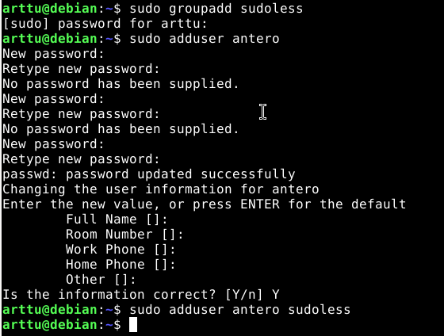
Käyttäjää luodessani yritin jättää salasanan tyhjäksi. Debian ei kuitenkaan hyväksynyt tyhjää salasanaa, vaan ilmoitti: No password has been supplied. Annoin käyttäjälle salasanan, ja käyttäjän luominen onnistui.

Määritin sudoless-ryhmän käyttäjille salasanattoman sudo-oikeuden. (Karvinen 2026)

```sudo visudo /etc/sudoers.d/sudoless```

Lisäsin tiedostoon rivin: ```%sudoless ALL = (ALL) NOPASSWD: ALL```

### SSH kirjautuminen

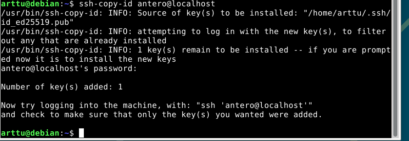
Määritin antero-käyttäjälle SSH kirjautumisen. Käytin aiemmin luotua SSH avainta arttu@debian käyttäjätililtä.

```
ssh-copy-id antero@localhost
ssh antero@localhost
```

Kirjautuminen onnistui ilman salasanaa. SSH-avainkirjautumsen avulla Ansible voi muodostaa yhteyden antero-käyttäjään automaattisesti. Eli nyt käytössä oli salasanaton sudo. (Karvinen 2026)
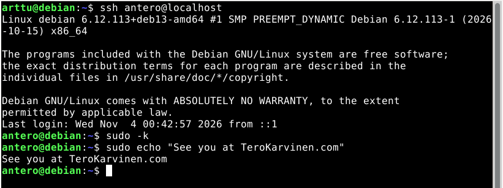

## b) Antero - salasanaton SSH-kirjautuminen Ansiblella

Tehtävän tavoitteena oli automatisoida uuden käyttäjätunnuksen luominen ja SSH-avainkirjautumisen määrittäminen Ansiblella. A-kohdassa käyttäjä luotiin käsin, mutta tässä kohdassa samat asiat toteutettiin Ansiblella. 

Käyttäjän luominen ja julkisen SSH-avaimen lisääminen automatisoidaan Ansible roolin avulla. Tähän käytetään user- ja authorized_key osia.  (Karvinen 2026)
Loin uuden Ansible-roolin hakemistoon roles/antero2/tasks/.

Lisäsin roolin roles/antero2/tasks/main.yml-tiedostoon kaksi tehtävää:
- user:lla luodaan käyttäjä nimeltä antero2.
- authorized_key:lla lisätään käyttäjälle Arttu-käyttäjän julkinen SSH-avain.

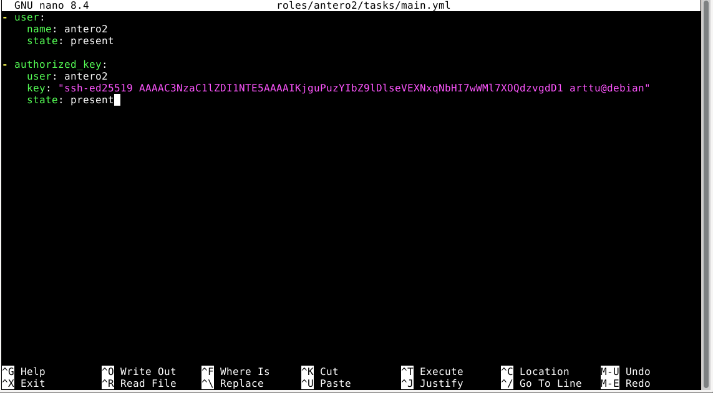

Lisäsin uuden roolin site.yml-tiedostoon.
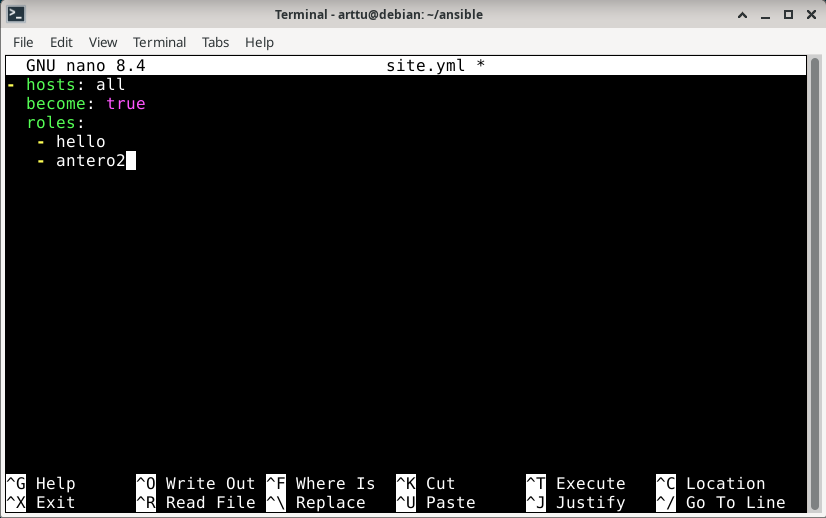

Suoritin Ansible-playbookin komennolla
```ansible-playbook site.yml --ask-become-pass```

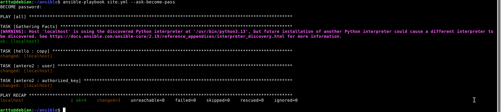
Ansible suoritti kaikki tehtävät onnistuneesti.

## c) Package

Tehtävän tavoitteena oli asentaa kaksi pakettia Ansiblella. Loin uuden packages-roolin.

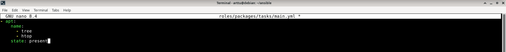
Uuden packages-roolin main.yml tiedosto, jossa näkyy kaksi valittua pakettia ja asennusasetukset.

Lisäsin site.yml tiedostoon uuden packages roolin ja suoritin Ansible-playbookin.

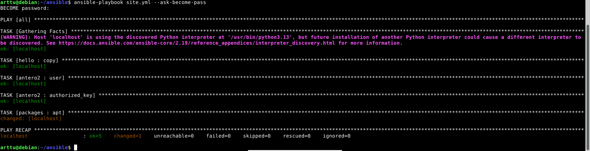
Pakettien asennus onnistui ilman virheitä.

## d) File

Tehtävän tavoitteena oli luoda monirivinen tiedosto Ansiblella, ja määrittää tiedoston omistaja, omistaja ja käyttöoikeudet.

Loin uuden file-roolin. Käytin tiedoston luomiseen copy-moduulia, jonka avulla voi kopioida tiedostoja tai määrittää tiedoston sisältö. (Karvinen 2026).

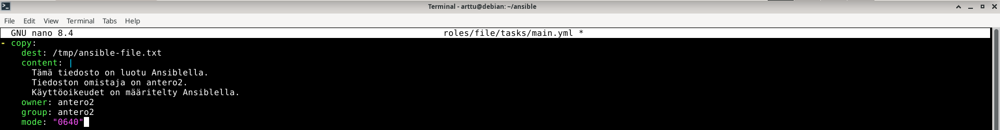
Määritin tiedoston sijainniksi /tmp/ansible-file.txt. Määritin omistajaksi ja omistavaksi ryhmäksi antero2-käyttäjän.
Asetin tiedoston käyttöoikeudeksi oktaaliluvun 0640, jonka symbolinen muoto on -rw-r-----.

Tiedoston omistaja voi lukea ja muokata tiedostoa, ryhmän jäsenet voivat lukea tiedostoa ja muilla ei ole käyttöoikeuksia.

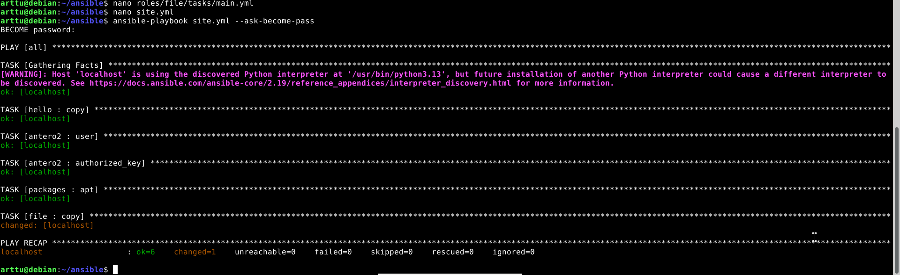
Ansible suoritti file-roolin copy-tehtävän onnistuneesti.

## e) Jotain muuta

Tehtävässä d) käytin Ansiblea tiedoston luomiseen copy-moduulilla. Tässä tehtävässä käytin file-moduulia. Loin uuden hakemiston /tmp/ansible-test ja määritin sille omistajan, ryhmän ja käyttöoikeudet. Lisäksi halusin harjoitella mm. state- ja path -parametrien käyttöä. 

Loin uuden roolin Ansiblessa nimeltä directory. Määritin hakemiston sijainniksi /tmp/ansible-test. Käytin parametria state: directory varmistaakseni, että hakemisto luodaan. Lisäksi määritin omistajaksi ja ryhmäksi antero2, ja käyttöoikeuksiksi 0750.

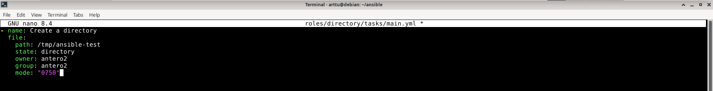

Hakemiston luominen onnistui Ansiblella. Playbookin suorittamisen jälkeen tarkistin sen tiedot ls -ld-komennolla. Hakemiston omistaja ja ryhmä olivat antero2 ja käyttöoikeudet olivat 0750, eli omistajalla on kaikki oikeudet, ryhmällä luku- ja suoritusoikeudet ja muilla ei oikeuksia.

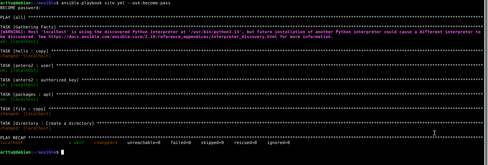


## Lähteet
Karvinen, T. 2026. Passwordless Sudo with Ansible. Luettavissa: https://terokarvinen.com/passwordless-sudo-with-ansible/. Luettu: 4.11.2026.

Karvinen, T. 2026. Sudo without password. Luettavissa: https://terokarvinen.com/passwordless-sudo/. Luettu: 4.11.2026.

Munroe, R. 2006. xkcd 149: Sandwich. Luettavissa: https://xkcd.com/149/. Luettu: 4.11.2026.

Tämän tehtävän tekemisessä hyödynsin ChatGPT:tä Ansible-komentojen kanssa tehtävissä a), b), c), d) ja e).
