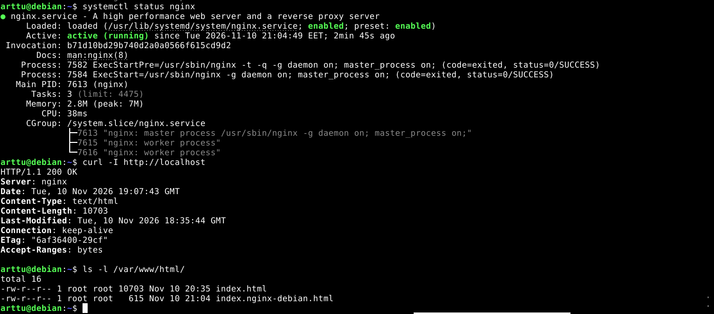
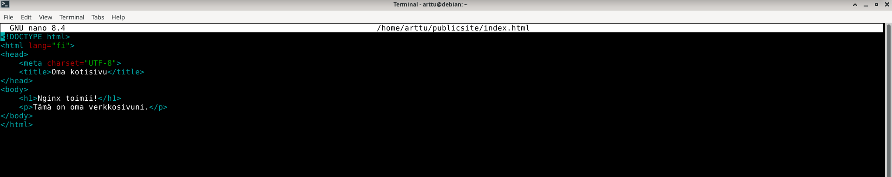
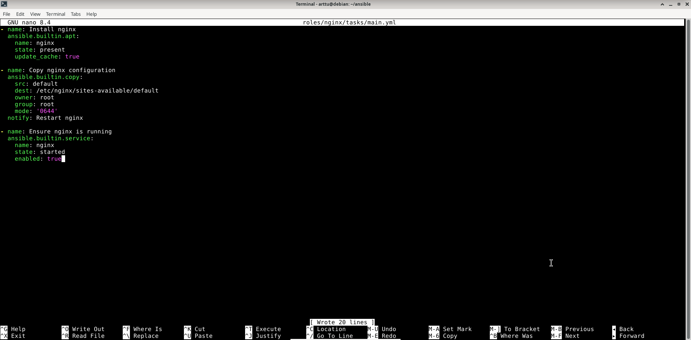
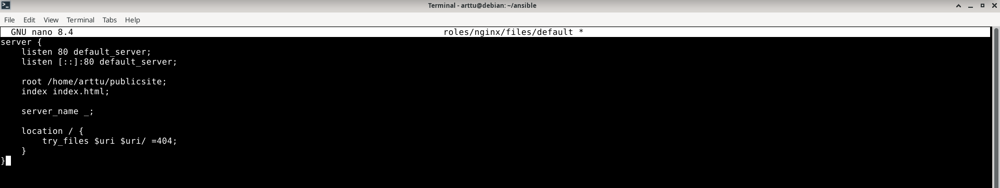
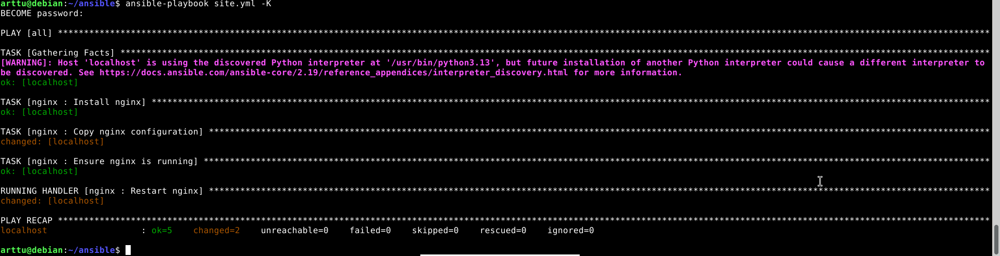

# H3 Tehtävät

## x) Karvinen 2026: Apache installed with Ansible - quick notes

- Package-file-service mallin idea on jakaa palvelimen asennus kolmeen osaan
- **Package:** Asennetaan paketti, esim Web-palvelin Apache2.
- **File:** Muokataan esim. Apache2:n tiedostoja
- **Service:** Käynnistetään tai uudelleenkäynnistetään palvelu

Huomio: Malli tekee palvelimen ylläpidosta selkeää, koska on kolme selkeää työvaihetta.

## Ansible Community Documentation: Handlers: running operations on change

- Ansible Handler on tehtävä, joka suoritetaan vain silloin, kun jokin toinen tehtävä ilmoittaa siitä notify-komennolla.
- Esimerkki:
  
```
tasks:
  - name: Template configuration file
  ansible.builtin.template:
    src: template.j2
    dest: /etc/foo.conf
  notify:
    - Restart apache
    - Restart memcached

handlers:
  - name: Restart memcached
    ansible.builtin.service:
      name: memcached
      state: restarted

  - name: Restart apache
    ansible.builtin.service:
      name: apache
      state: restarted
```
- Esimerkissä Ansible tarkistaa tiedoston template.j2.
- Jos tiedostossa ei ole muutoksia, mitään ei tapahdu.
- Jos tiedostossa on ollut muutoksia, Handler:lle tulee ilmoitus, ja molemmat handlerit suoritetaan.

## Ansible-doc service

- Ansible.builtin.service-moduulilla hallitaan etäkoneiden palveluita.
- Tukee useita käynnistysjärjestelmiä (init system), esim. systemd, SysV ja OpenRC.
- Moduulin ominaisuus on se, että se toimii välityspalvelimena eri käynnistysjärjestelmien välillä.
- Mahdollistaa sen, että samaa Ansible tehtävää voidaan käyttää eri Linux järjestelmissä ilman, että jokaiselle järjestelmälle tarvitsee tehdä omaa tehtävää.

### Enabled

- Määritetään, käynnistyykö palvelu automaattisesti tietokoneen käynnistyessä.
- Joko `true` tai `false`

### Name

- Määritetään, mitä palvelua halutaan hallita.
- Nimi voi olla esimerkiksi Apache2.

### State

- Määritetään palvelun haluttu tila.
- Vaihtoehtoina `started`, `stopped`, `restarted` ja `reloaded`.
- `Started` käynnistää palvelun tarvittaessa ja `stopped` pysäyttää sen.
- `Restarted` käynnistää palvelun aina uudelleen, `reloaded` lataa palvelun asetukset uudelleen.

### Esimerkki

- Käynnistää httpd-palvelun, jos se ei ole jo käynnissä:
```
- name: Start service httpd
  ansible.builtin.service:
    name: httpd
    state: started
```

## a) Apassi

Päivitin pakettiluettelon komennolla `sudo apt-get update` ja asensin Apache2:n komennolla `sudo apt install apache2`. 
Asennuksen jälkeen tarkistin Apachen tilan komennolla `systemctl status apache2`. Palvelu oli käynnissä.

Loin kotihakemistooni uuden kansion ja sen sisälle `index.html`-tiedoston. Lisäsin HTML-tiedostoon oman verkkosivuni sisällön, mikä näkyy Apache2 palvelimella.
Määritin kansioiden ja tiedoston käyttöoikeudet `chmod`-komennolla, että sivu olisi tavallisen käyttäjän muokattavissa ilman root- tai sudo-oikeuksia.

Tarkistin käyttöoikeudet `ls -ld`- ja `ls -l`-komennoilla.


Muokkasin Apachen oletussivuston asetustiedostoa `/etc/apache2/sites-available/000-default.conf`. Muutin `DocumentRoot`-asetuksen osoittamaan omaan kansiooni.
Tarkistin Apachen asetustiedoston komennolla `sudo apache2ctl configtest`. Komennon tulos oli `Syntax OK`, joten tiedostossa ei ollut virheitä.

Käynnistin Apache-palvelun uudelleen komennolla `sudo systemctl restart apache2` ja varmistin, että palvelu toimii.


## b) Moottorix

Pysäytin ensin Apache2:n komennolla `sudo systemctl stop apache2`, koska Apache ja Nginx eivät voi käyttää samaan aikaan porttia 80. Asensin Nginxin komennolla `sudo apt install nginx`.
Tarkistin Nginxin toiminnan komennolla `systemctl status nginx`. Palvelu oli käynnissä. 

Nginxin oletussivuna näkyi kuitenkin vielä Apachen oletussivu. Selvitin asian tarkistamalla /var/www/html/ kansion komennolla `ls -l`. Kansiossa oli Apachen `index.html` ja Nginxin `index.nginx-debian.html`. 
Nginx käytti oletuksena Apachen luomaa `index.html`-tiedostoa.


Muokkasin Nginxin asetustiedostoa `/etc/nginx/sites-available/default`. Muutin `root`-asetuksen osoittamaan omaan kansiooni, jotta Nginx näyttäisi tekemäni verkkosivun. 
Tarkistin asetusten toimivuuden komennolla `sudo nginx -t`. Komennon tulosteen perusteella asetuksissa ei ollut virheitä ja testi onnistui.

Käynnistin Nginx-palvelun uudelleen komennolla `sudo systemctl restart nginx`. Verkkosivuni näkyi osoitteessa `http://localhost`.
Hyödynsin Apache-tehtävässä määrittämiäni tiedostojen käyttöoikeuksia. Koska määritin Nginx:in käyttämään `home/arttu/publicsite/`-kansiota , samoja käyttöoikeuksia voitiin käyttää. Verkkosivu pysyi tavallisen käyttäjän muokattavissa ilman root- tai sudo-oikeuksia.

Testasin vielä verkkosivun muokkaamista tavallisena käyttäjänä. Avasin `index.html`-tiedoston ilman sudo-oikeuksia. Muutin sivun otsikkoa, jolla varmistin, että verkkosivu on tavallisen käyttäjän muokattavissa.


## c) Automoottorix

Loin Nginxille oman Ansible-roolin. Määritin roolin `main.yml`-tiedostoon Nginxin asennuksen apt-moduulilla. 
Copy-moduulilla määritin asetustiedoston kopioinnin ja service-moduulilla varmistin, että Nginx-palvelu on käynnissä ja käynnistyy automaattisesti tietokoneen käynnistyessä.


Loin Nginxille oman asetustiedoston `roles/nginx/files/default`. Ansible kopioi tämän tiedoston Nginxin asetushakemistoon.


Loin Nginx-roolille myös `handlers`-hakemiston ja sinne `main.yml`-tiedoston. Määritin handlerin käynnistämään Nginx:in uudelleen, jos asetustiedosto muuttuu. Lisäsin Nginx-roolin `site.yml`-tiedostoon muiden roolien alle.

Suoritin Ansible playbookin. Ansible varmisti Nginxin asennuksen, kopioi asetustiedoston palvelimelle ja tarkisti, että Nginx oli käynnissä. 
Koska asetustiedosto oli muuttunut, myös Handler suoritettiin ja Nginx käynnistyi uudelleen.
Ansible playbookin suoritus oli onnistunut.



## Lähteet

Ansible Community Documentation s.a. Handlers: running operations on change. Luettavissa: https://docs.ansible.com/projects/ansible/latest/playbook_guide/playbooks_handlers.html. Luettu: 10.11.2026.

Karvinen, T. 2026. Apache installed with Ansible – quick notes. Luettavissa: https://terokarvinen.com/apache-ansible/. Luettu: 10.11.2026.
