# H4 Tehtävät

## x) Karvinen 2023: Configuration Management of Distributed Systems over Unreliable and Hostile Networks

### 4.12.1 Size and Complexity of Some DSLs

- Salt on palvelinten konfigurointiin tarkoitettu työkalu, jolla voidaan hallita ja automatisoida tietokoneiden asetuksia, joka sisältää 510 erilaista toimintoa.
- Puppet on toinen samantyyppinen palvelinten työkalu, joka sisältää 113 komentoa.
- Työkalujen ohjelmointikielet ovat monimutkaisia.
- Salt käyttää Jinja2:n mallipohjia.
- Puppetissa käytetään omia käsitteitä.

### 4.12.2 Use of DSL Functions in Case Configuration

- Tutkimuksessa selvitettiin eniten käytettyjä toimintoja Mozillan ja USGCB:n Puppet palvelimilla.
- Yleisimmät toiminnot olivat `file-service`, `exec` ja `group`.
- Vaikka Puppetissa on paljon erilaisia toimintoja, vain pieni määrä niistä vastaa tarpeisiin.

### 4.12.3.1 Dependencies Between Main Functions

- Ohjelmien asentaminen ja palveluiden käyttöönotto liittyvät toisiinsa.
- Esim. palvelimen käyttöönotossa täytyy ensin asentaa ohjelma, määrittää sen asetukset ja lopuksi käynnistää palvelu. (Package-file-service)
- Idempotentti tarkoittaa halutun tilan ylläpitämistä, eli jos järjestelmän asetukset ovat jo oikein, niitä ei tarvitse muuttaa.

## a) Räpylä

Valitsin demoniksi Redis-palvelimen. Redis on tietokanta, jota käytetään esimerkiksi tiedon nopeaan tallentamiseen ja välimuistina.
Asensin Rediksen komennoilla `sudo apt-get update` ja `sudo apt-get install redis-server`. Tarkistin palvelun tilan `systemctl status redis-server`-komennolla josta näkyi, että palvelu on käynnissä.
Kokeilin palvelun toiminnan `redis-cli ping` -komennolla johon Redis vastasi PONG, eli ping testi onnistui.
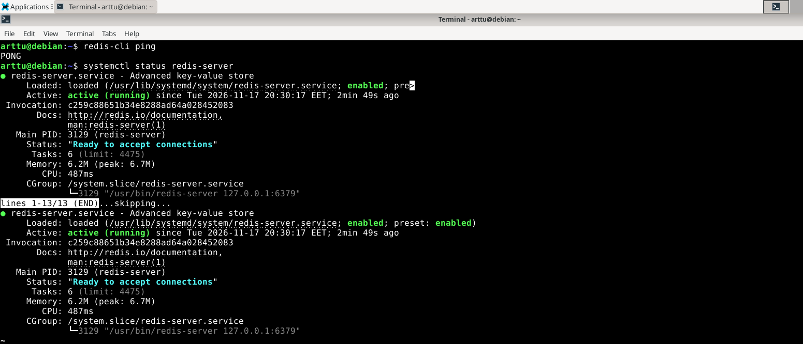

## b) Automaatti

Loin Redis-palvelimelle oman roolin Ansiblessa. Loin roolille kolme uutta kansiota: files, handlers ja tasks.

Lisäsin roles/redis/tasks/main.yml-tiedostoon Redis-palvelimen asennuksen. Mail.yml suoritetaan roolin käyttöönoton yhteydessä. Käytin asennuksessa apt-moduulia. Asennettava paketti oli redis-server. Asetuksella state: present varmistin, että Redis-palvelin on asennettuna.
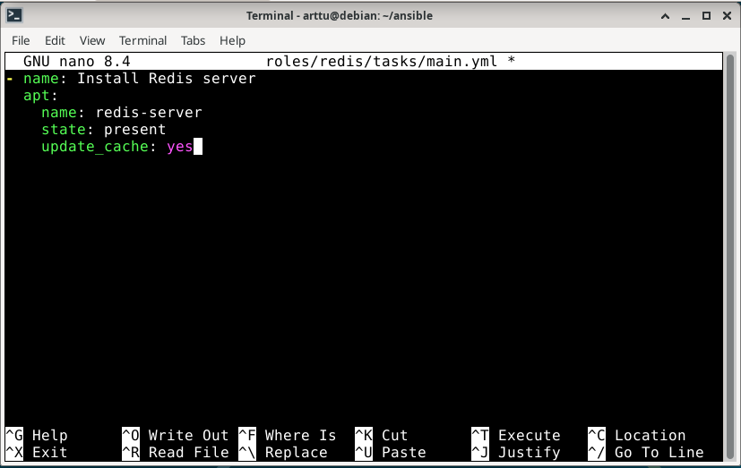

Lisäsin Redis-roolin site.yml-tiedostoon. 
Site.yml määrittää, mitä rooleja Ansible suorittaa hallittavilla koneilla, joten otin pois käytöstä aiemmin käytetyn Nginx-roolin, jolloin Ansiblen playbook suorittaa vain Redis-roolin.
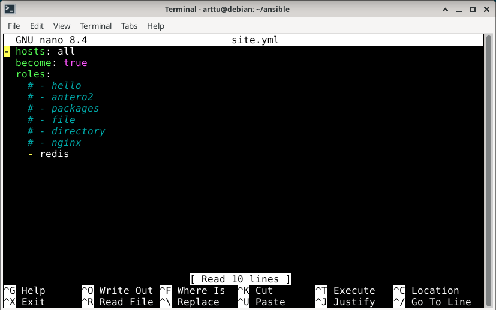

Suoritin Redis-roolin komennolla `ansible-playbook site.yml --ask-become-pass`. Ansiblen playbook suoritettiin onnistuneesti. Ansible tarkisti, että Redis-palvelin oli asennettuna. 
Koska olin asentanut sen jo aiemmin a-kohdassa, `changed=0` eikä Ansible tehnyt uusia muutoksia.
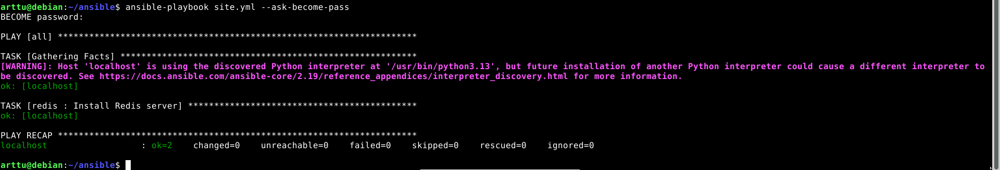

## c) Asetus

Muutin Redis-palvelimen asetuksia Ansiblella. Kopioin Redis-palvelimen alkuperäisen asetustiedoston `/etc/redis/redis.conf` Ansible-roolin files-kansioon, että pystyin muokkaamaan sitä.

Muokkasin asetustiedostoa lisäämällä siihen `maxmemory 64mb` -asetuksen. Tämä määrittää Redis-palvelimen muistin enimmäismääräksi 64 MB.
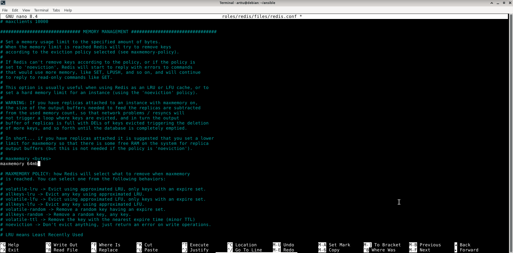

Lisäsin `roles/redis/tasks/main.yml`-tiedostoon uuden tehtävän, joka kopioi asetustiedoston. Määritin lähdetiedostoksi `redis.conf` ja kohteeksi `/etc/redis/redis.conf`. Lisäksi määritin tiedoston omistajaksi ja ryhmäksi redis ja käyttöoikeuksiksi 0640. Lisäsin tehtävään myös `notify: Restart Redis kohdan`, että Ansible käynnistää Rediksen uudelleen, jos asetustiedosto on muuttunut.
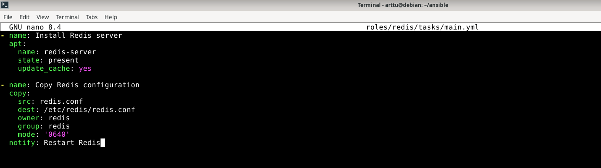

Loin roles/redis/handlers/main.yml-tiedostoon handlerin, joka käynnistää Redis-palvelun uudelleen. Handleria tarvitaan, jotta Redis ottaa uuden asetustiedoston käyttöön.
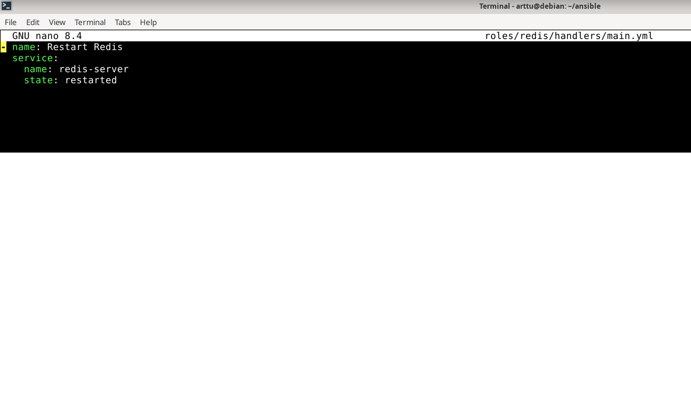

Ensimmäisellä Ansible playbook ajolla tapahtui virhe. Ansible ei pystynyt lukemaan files kansiossa olevaa asetustiedostoa, koska tiedoston omistaja oli root.
Korjasin ongelman vaihtamalla tiedoston omistajaksi itseni komennolla `sudo chown arttu:arttu roles/redis/files/redis.conf`. 
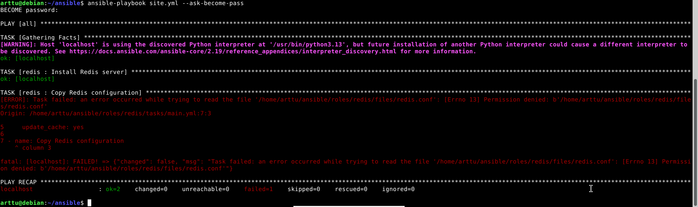

Korjauksen jälkeen suoritin Ansible playbookin uudelleen. Suoritus onnistui. Ansible kopioi uuden asetustiedoston ja käynnisti Rediksen uudelleen.
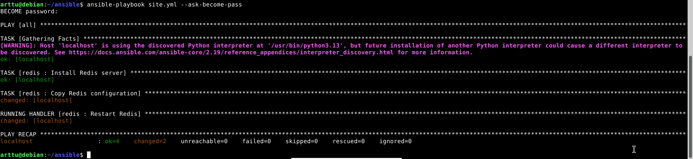

Lopuksi tarkistin, että uusi asetus oli tullut käyttöön komennolla `redis-cli CONFIG GET maxmemory`. 67108864 on 64 megatavua, eli asetusmuutos oli onnistunut. 

## d) Paikka remonttiin

Poistin Redis-palvelimen asetustiedoston `/etc/redis/redis.conf` komennolla `sudo rm /etc/redis/redis.conf`. Tämä rikkoi Redis-palvelimen asetukset poistamalla sen asetustiedoston.
Suoritin Ansible playbookin uudelleen. Tuloksesta näkyi changed=2 ja failed=0, eli Ansible teki kaksi muutosta eikä suoritus sisältänyt virheitä. 
Ansible palautti puuttuneen asetustiedoston ja käynnisti Redis-palvelun uudelleen.
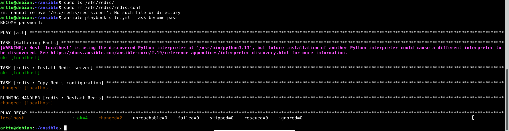

## e) Idempotentti

Kokeilin, että Ansible rooli on idempotentti suorittamalla playbookin uudelleen.
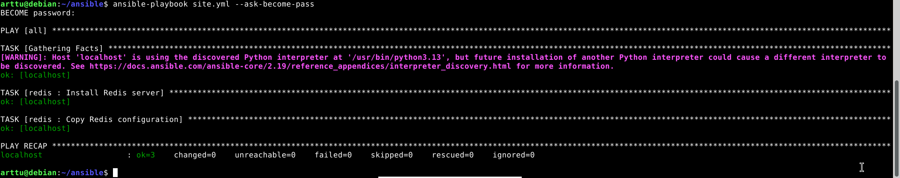

Playbook suoritettiin onnistuneesti, eikä järjestelmään tehty muutoksia. Yhteenvedosta näkyi ok=3, changed=0 ja failed=0. mikä tarkoitti, että kaikki kolme tehtävää suoritettiin onnistuneesti, mutta mitään ei tarvinnut muuttaa.

## Lähteet

Käytin ChatGPT-tekoälyä apuna Main.yml tiedostojen määrittämisessä, Redis-palvelun handlerin luomisessa ja käyttöoikeusvirheen selvittämisessä.

Karvinen, T. 2024. Configuration Management of Distributed Systems over Unreliable and Hostile Networks. Väitöskirja. University of Westminster. Luettavissa: https://westminsterresearch.westminster.ac.uk/item/w7vvz/configuration-management-of-distributed-systems-over-unreliable-and-hostile-networks. Luettu: 17.11.2026.

