# H5 Tehtävät

## x) Chacon and Straub 2014: Pro Git, 2ed: 1.3 Getting Started - What is Git?

- Git tallentaa projektin tiedot tilannekuvina (snapshots).
- Kun projektiin tehdään commit, git tallentaa viittauksen projektin senhetkiseen tilaan.
- Git projektin koko historia on käyttäjän omalla tietokoneella, joten esimerkiksi commitien tekeminen onnistuvat ilman verkkoyhteyttä.
- Gitissä tiedostoilla on kolme tilaa: modified, staged ja committed.
- Gitissä kolme tärkeintä aluetta ovat working tree, staging area ja git directory. (Chacon & Straub 2014, luku 1.3.)

`git add --all && git commit; git pull && git push`

- git add --all lisää valmistelualueelle (staging area) kaikki tiedostojen muutokset. (Git s.a.)
- && on Bashia. Seuraava komento suoritetaan vain, jos edellinen komento onnistuu. (GNU s.a.)
- Git commit luo uuden commitin. (Git s.a.)
- ; erottaa komennot toisistaan (GNU s.a.)
- Git pull hakee muutokset etävarastosta (esim. Github) ja yhdistää ne nykyiseen haaraan. (Git s.a.)
- Git push lähettää tehdyt muutokset (commitit) etävarastoon. (Git n.d.-d.)

## Lähteet

Chacon, S. & Straub, B. 2014. Pro Git, 2nd Edition. Luku 1.3: What is Git? Luettavissa: https://git-scm.com/book/en/v2/Getting-Started-What-is-Git. Luettu 25.11.2026.

Git s.a. Git Add Documentation. Luettavissa: https://git-scm.com/docs/git-add. Luettu 25.11.2026.

Git s.a. Git Commit Documentation. Luettavissa: https://git-scm.com/docs/git-commit. Luettu 25.11.2026.

Git s.a. Git Pull Documentation. Luettavissa: https://git-scm.com/docs/git-pull. Luettu 25.11.2026.

Git s.a. Git Push Documentation. Luettavissa: https://git-scm.com/docs/git-push. Luettu 25.11.2026.

GNU s.a. Bash Reference Manual. Luku 3.2.4: Lists of Commands. Luettavissa: https://www.gnu.org/software/bash/manual/bash.html#Lists. Luettu 25.11.2026.

## a) Online

Loin GitHubiin uuden repositorion nimeltä sunshine-h5-git. Lisäsin varastoon README.md-tiedoston ja valitsin lisenssiksi GNU General Public License v3.0 -lisenssin.
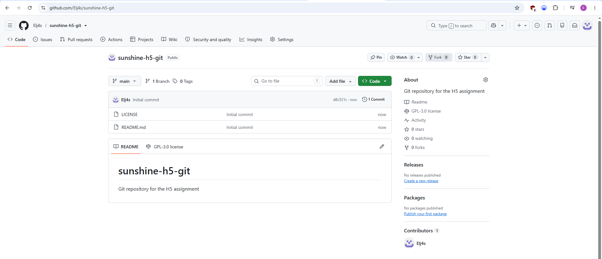

## b) Dolly

Lisäsin virtuaalikoneen SSH avaimen Githubiin ja testasin SSH yhteyden. Kloonasin luomani repositorion virtuaalikoneelle komennolla `git clone git@github.com:Elj4s/sunshine-h5-git.git`. 
Tarkistin, että tiedostot tulivat komennolla ls -l. 
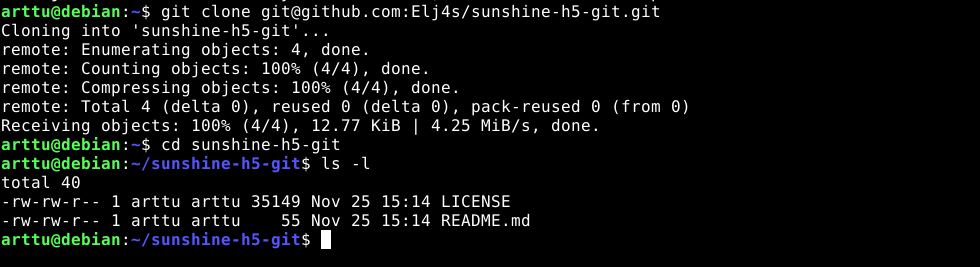

Tein muutoksia muokkaamalla README.md tiedostoa. Lisäsin tiedostoon tekstin "This repository is used for practicing."
Tarkistin tiedoston sisällön komennolla `cat README.md` ja gitin tilan komennolla git status. Git tunnisti muutoksen README.md tiedostossa.
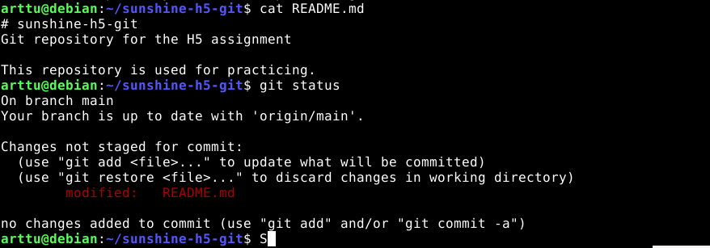

Lisäsin muutoksen staging area:lle, tein commitin ja lähetin sen Githubiin komennoilla:
```
git add .
git commit -m "Update README"
git push
```
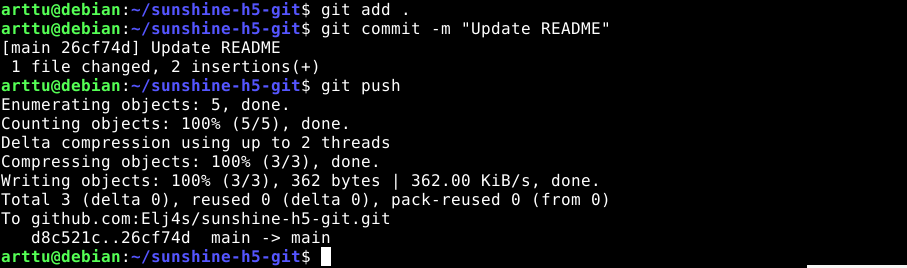

Commit ja push onnistui. Tarkistin GitHubin verkkosivulta, että muutos oli ilmestynyt webbiliittymään.
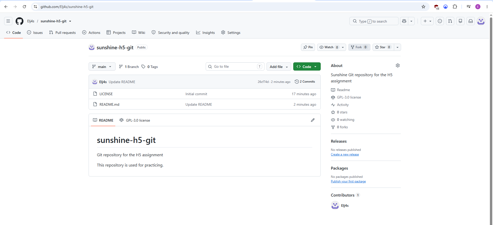

## c) Doh

Harjoittelin Gitin tekemien muutosten peruuttamista. Lisäsin README.md-tiedostoon uuden tekstin ilman, että tein muutoksesta committia. Tarkistin muutoksen git status komennolla. 
Suoritin komennon git reset --hard, joka palautti hakemiston viimeisimmän commitin tilaan ja poisti tekemäni muutoksen. 

Tarkistin README.md-tiedoston sisällön ja suoritin git status komennon. Git ilmoitti, että uusia muutoksia ei ole.
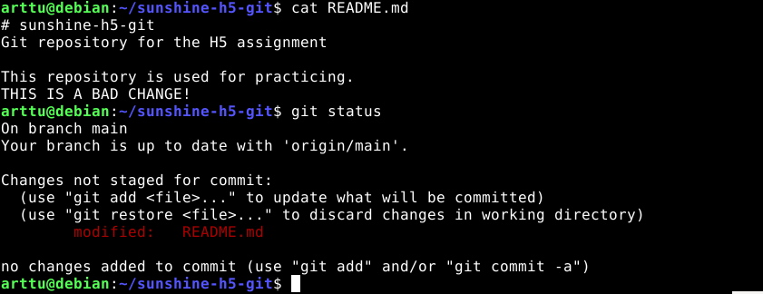

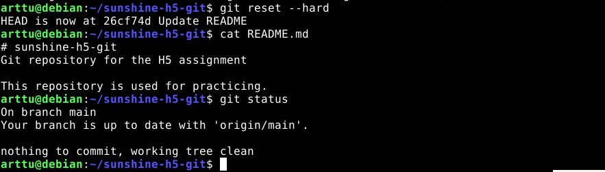

## d) Tukki

Katsoin hakemiston commit-historiaa komennolla `git log`. Komento näytti commitien kaikki tunnisteet, tekijätiedot ja päivämäärät.
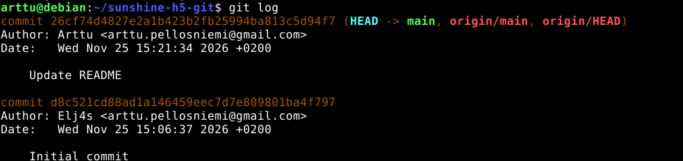

Suoritin komennon `git log --patch`, jolla tarkastelin commitien tiedostomuutoksia. Komennon tulosteesta näkyi, mitä rivejä tiedostoihin oli lisätty tai poistettu. Nimeni ja sähköpostiosoitteeni näkyivät haluamallani tavalla.
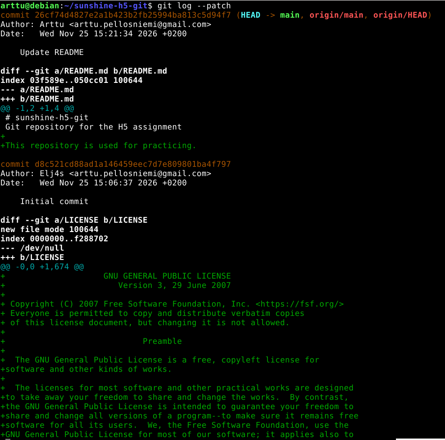

## e) Gitanbile

Lisäsin Ansible hakemistoni Gitiin. Alustin versionhallinnan kansiossa komennolla `git init` ja lisäsin ansible hakemiston kaikki tiedostot komennolla `git add .`
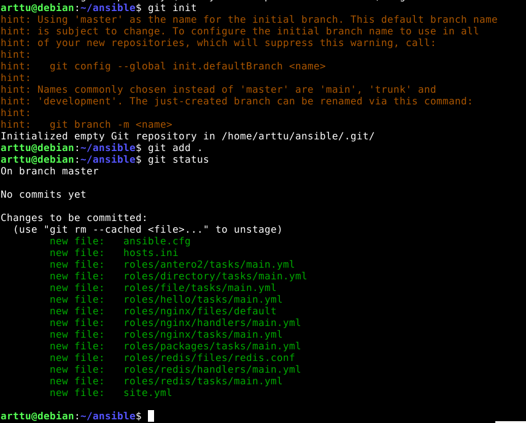

Tein muutoksen site.yml tiedostoon ottamalla Nginx-roolin käyttöön ja ottamalla muut roolit pois käytöstä.
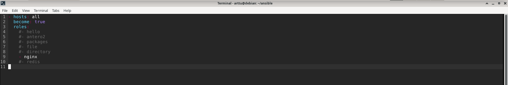

Ajoin Ansible playbookin. Ansible suoritti aiemmin tekemäni Nginx roolin onnistuneesti.


Lopuksi lisäsin muutokset staging area:lle ja tallensin ne uudella commitilla.

```
git add .
git commit -m "Enable nginx role in Ansible playbook"
```

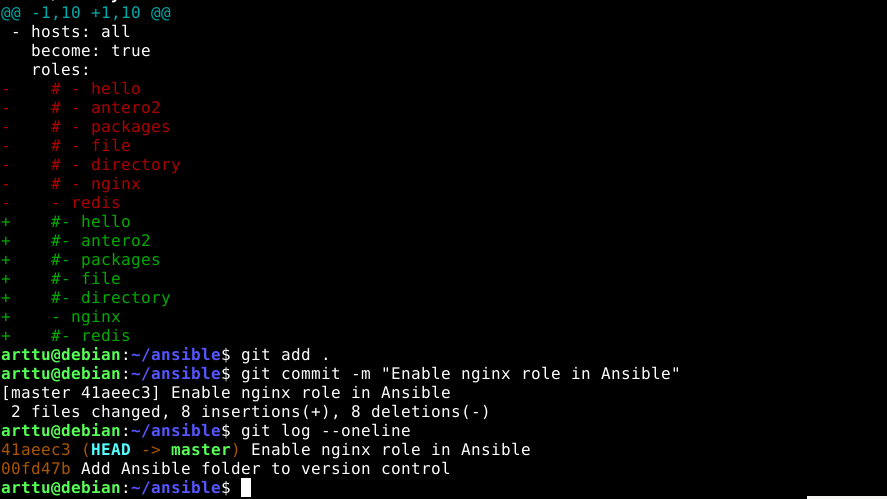
